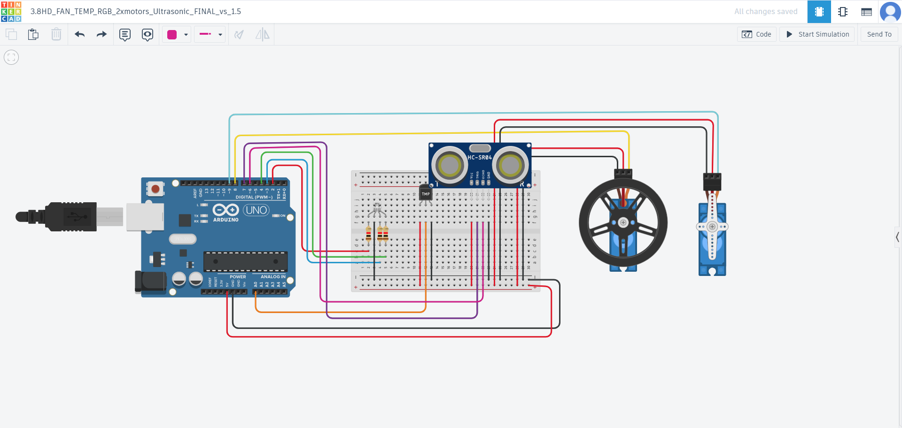
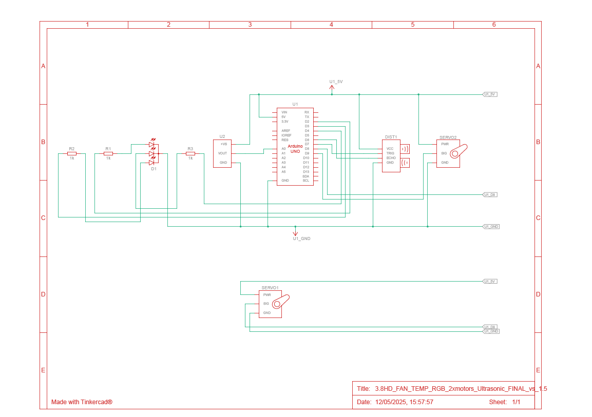

# Smart Desk Fan (Arduino + CLI)

A desktop cooling fan that turns itself on only when two things happen at once: the room gets too warm (over **30°C**) and someone is sitting at the desk (within **20 cm**).

Built with an **Arduino Uno**, basic sensors, and two micro servos—compiled and run straight from the command line using `arduino-cli`.

---

## How It Works

- **Checks if someone is at the desk:** An ultrasonic distance sensor mounted on a sweeping servo scans the desk area and measures proximity in centimeters.
- **Shows room comfort at a glance:** An RGB LED changes color based on live temperature readings:
  - 🔵 **Blue (`< 10°C`):** Cold
  - 🟢 **Green (`10°C – 30°C`):** Comfortable
  - 🔴 **Red (`> 30°C`):** Too hot
- **Saves power automatically:** Even if the room is over 30°C, the fan stays off until you sit down within 20 cm of the sensor.

---

## Parts & Wiring

| Part                          | Arduino Pin                   | What It Does                                  |
| :---------------------------- | :---------------------------- | :-------------------------------------------- |
| **DHT11 Sensor**              | `D4`                          | Reads room temperature and humidity           |
| **HC-SR04 Ultrasonic**        | `D7` (TRIG), `D6` (ECHO)      | Checks how close you are to the desk          |
| **RGB LED (+ 1kΩ resistors)** | `D10` (R), `D9` (G), `D8` (B) | Lights up Blue, Green, or Red for temp        |
| **Fan Servo**                 | `D2`                          | Moves the fan when it's hot and you're nearby |
| **Scanner Servo**             | `D3`                          | Sweeps the ultrasonic sensor back and forth   |

---

## Circuit & Schematic

### Breadboard Layout



### Wiring Schematic



---

## Running It via Arduino CLI

1. **Install the board support and libraries:**

   ```bash
   arduino-cli core update-index
   arduino-cli core install arduino:avr
   arduino-cli lib install "DHT11" "Servo"
   ```

2. **Compile and upload to the board** (replace `COM4` with your port):

   ```bash
   cd FAN
   arduino-cli compile -b arduino:avr:uno -u -p COM4
   ```

3. **Watch the live temperature and distance readings:**
   ```bash
   arduino-cli monitor -p COM4 -c baudrate=9600
   ```

---

## Ideas for Next Version

- Replace blocking `delay()` loops with `millis()` timers so the sensor sweeps and fan react at the exact same time.
- Swap in a continuous rotation motor with 3D-printed fan blades for stronger airflow.
- Add Bluetooth or an SD card module to log desk temperatures over time.

---

🎥 **[Watch Hardware Demo Video](docs/smart-fan-demo.mp4)**

https://github.com/user-attachments/assets/6c5db3d3-c5d5-40b1-9e34-94b47d372853

---
